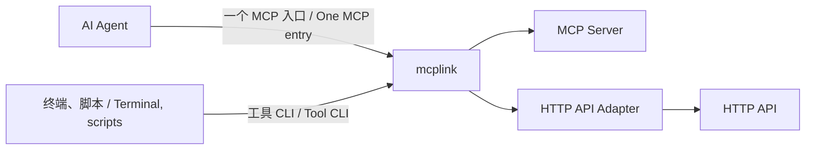

# mcplink

[](https://github.com/sw897/mcplink/actions/workflows/ci.yml)
[](LICENSE)

mcplink 将 MCP Server 和普通 HTTP API 接到每个 Agent 的一个 MCP 入口中，并让这些工具可从终端、脚本和自动化任务调用。服务、认证和工具访问范围可通过桌面或 CLI 统一维护。

mcplink connects MCP servers and ordinary HTTP APIs through one MCP entry per agent, and makes their tools callable from terminals, scripts, and automation. Manage services, authentication, and tool access from the desktop or CLI.

统一入口、单服务入口和工具 CLI 复用同一份托管连接。免费、MIT 开源，使用本机管理功能无需注册 mcplink 账号。上游服务仍保留各自的认证与访问要求。

Unified entries, single-service entries, and tool CLIs reuse the same managed connections. Free and MIT-licensed, with no mcplink account required. Upstream services retain their own authentication and access requirements.

[下载 / Download](#install-and-build) · [快速上手 / Quick start](#quick-start) · [HTTP API 转 MCP / HTTP API-to-MCP](#http-api-to-mcp) · [CLI 指南 / CLI guide](docs/agent-cli.md) · [项目文档 / Documentation](docs/README.md)

<a id="core-capabilities"></a>

## 核心能力 / Core capabilities

| 能力 / Capability | 使用方式 / How you use it |
| --- | --- |
| MCP 统一接入 / Unified MCP access | 每个 Agent 配置一个 `mcplink` 入口，使用所选服务的工具、资源和提示词；支持命名空间、每入口工具范围、分页和清单刷新通知。<br>Configure one `mcplink` entry per agent to use selected services. Aggregate tools, resources, and prompts with namespaces, per-entry tool ranges, pagination, and refresh notifications. |
| MCP 转 CLI / MCP-to-CLI | 直接调用工具或生成具名命令，支持 JSON stdin、Schema 校验、结构化结果和契约检查，复用托管认证。<br>Call tools directly or generate named commands, with JSON stdin, schema validation, structured results, contract checks, and the same managed authentication. |
| HTTP API 转 MCP / HTTP API-to-MCP | 用声明式工具参数及 HTTP 请求/结果映射注册 Webservice，通过同一个 MCP 入口和 CLI 使用，无需另写 MCP Server。<br>Register a web service with declarative tool parameters and HTTP request/response mappings. Use its tools through the same MCP entry and CLI, without writing a separate MCP server. |



<a id="install-and-build"></a>

## 安装与构建 / Install and build

下载 **[0.3.2 预览版 / Preview](https://github.com/sw897/mcplink/releases/tag/v0.3.2)**，支持 macOS Apple Silicon 和 Windows x64。Release 提供安装包、独立 CLI、SHA-256 校验值和公开构建清单。

Download the **[0.3.2 preview](https://github.com/sw897/mcplink/releases/tag/v0.3.2)** for macOS Apple Silicon or Windows x64. The release includes installers, standalone CLIs, SHA-256 checksums, and public build manifests.

| 平台 / Platform | 安装方式 / Installation |
| --- | --- |
| macOS Apple Silicon | 打开 DMG 或 App ZIP，将 `mcplink.app` 复制到 `/Applications`。<br>Open the DMG or App ZIP and copy `mcplink.app` to `/Applications`. |
| Windows x64 | 运行 NSIS 安装包，也可使用独立 CLI ZIP。<br>Run the NSIS installer. A standalone CLI ZIP is also available. |
| 独立 CLI / Standalone CLI | 使用对应平台的 CLI 归档；或在源码目录运行 `cargo install --path crates/mcplink-core --locked`，将 Cargo 的可执行目录加入 PATH。<br>Use the platform's CLI archive, or run `cargo install --path crates/mcplink-core --locked` from a source checkout and add Cargo's executable directory to PATH. |

将应用与 CLI 保留在固定路径。升级时同步更新桌面和独立 CLI，并重启后台。0.3.2 沿用数据语义版本 5，management API 升为 22；新契约诊断要求新版后台，较早的程序仍不能打开其不支持的数据目录。

Keep the application and CLI at permanent paths. Upgrade the desktop and standalone CLI together, then restart the background process. Version 0.3.2 retains data semantics 5 and raises management API to 22. The new contract diagnostics require the updated backend; older binaries still refuse unsupported data directories.

macOS 预览包采用 ad-hoc 签名、未公证，Windows 包未签名。Intel Mac 和 Linux 暂无已验收的安装包。兼容性、签名和校验值见[发布说明](docs/release-notes.md)与[发布指南](docs/release.md)；成功的 [CI 构建](https://github.com/sw897/mcplink/actions/workflows/ci.yml)也提供 `packages-*` 工件。

The macOS preview uses ad-hoc signing and is not notarized; Windows packages are unsigned. Intel Mac and Linux do not have validated installer packages. See the [release notes](docs/release-notes.md) and [release guide](docs/release.md) for compatibility, signing, and checksum details. Successful [CI builds](https://github.com/sw897/mcplink/actions/workflows/ci.yml) also provide `packages-*` artifacts.

开发与打包命令见[从源码构建 / Build from source](#build-from-source)。

For development and packaging commands, see [Build from source](#build-from-source).

<a id="quick-start"></a>

## 快速上手 / Quick start

1. 安装并打开 mcplink，或使用管理 CLI。<br>
   Install mcplink and open it, or use the management CLI.
2. 导入已有服务，添加本地 STDIO 命令、远程 MCP 地址，或注册 HTTP API 定义。<br>
   Import an existing service, add a local STDIO command or remote MCP URL, or register an HTTP API definition.
3. 提供所需认证并查看工具。HTTP API 的“查看工具”只读本地定义；“运行探测”单独确认后才发出真实请求，也可通过工具 CLI 明确调用。<br>
   Supply any required authentication and inspect the tools. For HTTP APIs, “View tools” reads the local definition; “Run probe” sends a real request only after separate confirmation. Tool CLI also supports an explicit call.
4. 创建统一入口，选择服务和工具范围，再接给目标 Agent。核对并应用配置预览。<br>
   Create a unified entry, select services and tool ranges, then connect it to the target agent. Review and apply the proposed configuration changes.
5. 重新加载 Agent 的 MCP 配置，实际调用一次工具确认可用。<br>
   Reload the agent's MCP configuration and make a tool call to confirm access.

入口工具范围和工具 CLI 均支持按搜索结果批量选择或取消，保留搜索范围之外的选择；“清空全部选择”单独作用于全部工具。

Entry tool ranges and Tool CLI support selecting or deselecting search results in bulk while preserving selections outside the search. **Clear all selections** applies to the entire list.

后续在 mcplink 中调整服务选择，保留同一个 Agent 入口。支持实时刷新的客户端会收到清单变更通知，其他客户端需要重载 MCP。也可点击“通知 Agent 刷新”或运行 `mcplink gateway refresh ENTRY_ID`。

Update service selection in mcplink while retaining the same agent entry. Clients with live refresh receive list-change notifications; other clients need MCP reload. Use “Notify agents to refresh” or `mcplink gateway refresh ENTRY_ID` to request a fresh list.

<a id="supported-agents"></a>

## 支持的 Agent / Supported agents

Codex, Hermes, Claude Code, OpenCode, ZCode, DeepSeek Harness, OpenClaw, Kimi Code, WorkBuddy, 千问办公 (QwenWork), Pi Agent, 豆包工作 (Doubao Work).

各客户端的配置作用域、支持操作和接入要求统一列在 [Agent 兼容矩阵](docs/agent-discovery.md)。项目或 profile 来源需显式添加；插件和系统托管等来源保留原有权限。

Configuration scopes, supported operations, and client requirements are listed in the [Agent compatibility matrix](docs/agent-discovery.md). Project and profile sources are added explicitly; plugin and managed sources retain their permissions.

<a id="agent-integration-and-authentication"></a>

## Agent 接入与认证 / Agent integration and authentication

| 方式 / Mode | 连接与认证 / Connection and authentication |
| --- | --- |
| 统一入口 / Unified entry | 一个 `mcplink` 条目提供所选服务，引用各成员原有的托管连接；工具、提示词和资源 URI 使用稳定命名空间。<br>One `mcplink` entry exposes selected services and reuses each member's managed connection. Tools, prompts, and resource URIs use stable namespaces. |
| 单服务入口 / Single-service entry | 一个 Bridge 提供一项托管服务，保留上游名称。<br>A Bridge exposes one managed service and preserves its upstream names. |
| 原生直连，可选 / Native direct connection, optional | Agent 自行连接上游并维护认证。普通 HTTP API 需要 mcplink Adapter，通过共享方式接入。<br>The agent connects to the upstream itself and maintains its own authentication. Ordinary HTTP APIs require the mcplink Adapter and shared access. |

托管认证复用限于同一本机 mcplink 数据目录中的同一服务连接、账号和授权范围。上游允许时刷新 Token 或 OAuth grant，撤销或无法续期时需要重新认证。工具 CLI 引用这些连接，不另建账号。

Managed authentication is reused only for the same service connection, account, and authorization scope within one local mcplink data directory. Tokens or OAuth grants refresh when the upstream permits it; revoked or nonrenewable grants need reauthorization. Tool CLIs reference these same connections without creating another account.

共享配置保存本地程序入口和连接引用，上游凭据留在系统凭据库。直连配置包含完整地址、凭据和启动参数，应用前需核对保存与共享范围。

Shared agent configurations contain launcher and connection references; upstream credentials stay in the system credential store. Direct configurations contain complete URLs, credentials, and launch arguments. Review their storage and sharing scope before applying them.

配置变更支持预览、并发修改检查、备份和逐条恢复。迁移到统一入口时，只有明确选择替换，才移除成员服务已有的共享条目。移动程序后，需要从新路径重新生成共享入口。

Configuration changes support preview, concurrent-edit checks, backups, and per-operation recovery. Migrating to a unified entry replaces existing member-service shared entries only when explicitly selected. After moving the executable, regenerate shared entries from its new path.

<a id="mcp-to-cli"></a>

## MCP 转 CLI / MCP-to-CLI

直接调用连接中的工具，或为所选工具生成命令。调用方需要本机 mcplink 运行时，无需打开桌面或配置原生 MCP 客户端。以下占位符使用已有托管连接 ID 和实际工具名：

Call a connection's tools directly or generate commands for selected tools. The caller needs the local mcplink runtime, without having to open the desktop or configure a native MCP client. Replace the placeholders with a managed connection ID and an actual tool name:

```sh
mcplink connections tools CONNECTION_ID --tool TOOL_NAME
mcplink call CONNECTION_ID TOOL_NAME --stdin
mcplink cli generate CONNECTION_ID --name notes --output ./notes-cli --tool TOOL_NAME
mcplink cli check ./notes-cli/notes.mcplink.json
```

通过 stdin 传入工具参数 JSON。生成的命令清单不含凭据，调用时复用托管认证。在服务或统一入口中打开“工具 CLI”，可以查看参数、生成命令、检查契约，或明确执行一次工具调用。契约检查区分工具变化、移除或范围排除，以及授权或连接故障导致的未能核验，并展示已保存参数的变化摘要。输入格式、退出码和重新绑定见 [CLI 指南](docs/agent-cli.md)。

Pass the tool's argument JSON to stdin. Generated commands keep credentials out of their manifests and reuse managed authentication. Open **Tool CLI** from a service or unified entry to inspect parameters, generate commands, check contracts, or explicitly invoke a tool once. Checks distinguish changed, removed or filtered tools from contracts left unchecked by authentication or connection failures, and summarize changes to saved parameters. See the [CLI guide](docs/agent-cli.md) for input formats, exit codes, and rebinding.

<a id="http-api-to-mcp"></a>

## HTTP API 转 MCP / HTTP API-to-MCP

注册基础 URL 和声明式 `httpApi` 工具定义，将普通 HTTP 操作转换为 MCP 工具，映射路径、query 参数、JSON 请求体及结果字段。此能力从 0.3.0 开始提供。

Register a base URL and a declarative `httpApi` tool definition. Path and query parameters, JSON request bodies, and response mappings turn ordinary HTTP operations into MCP tools. This capability is available from 0.3.0.

项目包含两个无 Key 示例：

Two keyless examples are included:

```sh
mcplink connections save --stdin < examples/http-api/quickchart.json
mcplink connections save --stdin < examples/http-api/open-meteo.json
mcplink connections tools CONNECTION_ID
mcplink connections probe CONNECTION_ID
```

连接 ID 使用保存命令的返回值。QuickChart 将图表 JSON 渲染为 PNG，Open-Meteo 返回天气 JSON。例如，将 `OPEN_METEO_CONNECTION_ID` 替换为天气连接 ID：

Use the IDs returned by registration. QuickChart renders chart JSON as a PNG; Open-Meteo returns weather JSON. For example, replace `OPEN_METEO_CONNECTION_ID` with the weather connection's ID:

```sh
mcplink call OPEN_METEO_CONNECTION_ID get_weather --stdin <<'JSON'
{"latitude":31.23,"longitude":121.47,"timezone":"Asia/Shanghai"}
JSON
```

将两项服务加入同一个统一入口，即可由每个 Agent 的一个 MCP 条目调用，也可直接通过 CLI 使用。工具发现只检查本地定义；示例中显式配置的 probe 会执行一次真实 API 调用。

Add both services to a unified entry for one MCP entry per agent, or call them through the CLI. Listing tools checks only the local definition. The examples' explicitly configured probes make one real API call.

Adapter 支持 JSON、UTF-8 文本、PNG/JPEG/WebP 图片字节和映射后的 Base64 图片结果。图片作为 MCP 图片内容返回。凭据使用托管请求头；普通 HTTP API 不使用 MCP OAuth 发现，也不能导出为原生 MCP 直连地址。

The adapter supports JSON, UTF-8 text, PNG/JPEG/WebP image bytes, and mapped Base64 image responses. Images return as MCP image content. Credentials use managed headers; MCP OAuth discovery and native direct export do not apply to ordinary HTTP APIs.

当前采用显式操作定义，尚未提供 OpenAPI 导入、multipart 上传或异步任务。公共服务保留各自的限额与条款；Open-Meteo 免费入口限非商业用途。定义方式、映射规则及限制见 [HTTP Adapter 指南](docs/http-api.md)。

Operations are defined explicitly. OpenAPI import, multipart uploads, and asynchronous jobs are not included. Public services retain their rate limits and terms; Open-Meteo's free endpoint is for non-commercial use. See the [HTTP Adapter guide](docs/http-api.md) for definitions, mapping rules, and limits.

<a id="management-cli-and-skill"></a>

## 管理 CLI 与 Skill / Management CLI and Skill

Agent 和脚本可以无 UI 管理 mcplink。先检查安装版本的 JSON 命令契约和实际连接状态：

Agents and scripts can manage mcplink without UI. Start with the installed build's JSON command contract and actual connection state:

```sh
mcplink schema
mcplink status
```

桌面、管理 CLI 和内置 Skill 共用连接、凭据、配置预览与恢复操作。服务盘点、账号标签、工具策略及后台控制由同一个核心维护。macOS 菜单栏和 Windows 托盘支持登录启动、暂停状态保存和退出控制。安装与管理流程见 [CLI 指南](docs/agent-cli.md)。

The desktop, management CLI, and bundled Skill share connection, credential, configuration-preview, and recovery operations. Service inventory, account labels, tool policies, and background controls are maintained through the same core. macOS menu bar and Windows tray controls support login startup, persistent pause, and exit options. See the [CLI guide](docs/agent-cli.md) for installation and management workflows.

<a id="build-from-source"></a>

## 从源码构建 / Build from source

桌面采用 Tauri 2、React、TypeScript 和 Rust。安装 [.node-version](.node-version) 固定的 Node.js 22 LTS（最低 22.12.0）、[rust-toolchain.toml](rust-toolchain.toml) 中的工具链、Python 3.11+ 及 [Tauri 平台构建工具](https://v2.tauri.app/start/prerequisites/)。macOS 需要 Xcode Command Line Tools，Windows 需要 MSVC 构建工具和 WebView2。

The desktop uses Tauri 2, React, TypeScript, and Rust. Install Node.js 22 LTS as pinned in [.node-version](.node-version) (minimum 22.12.0), the toolchain in [rust-toolchain.toml](rust-toolchain.toml), Python 3.11+, and the [Tauri platform prerequisites](https://v2.tauri.app/start/prerequisites/). macOS requires Xcode Command Line Tools; Windows requires MSVC build tools and WebView2.

```sh
git clone https://github.com/sw897/mcplink.git
cd mcplink
npm ci
npm run desktop
```

| 命令 / Command | 用途 / Purpose |
| --- | --- |
| `npm run build` | 检查类型并构建前端。<br>Type-check and build the frontend. |
| `npm run check` | 检查 Rust 格式并运行静态分析。<br>Check Rust formatting and run static analysis. |
| `npm run release:macos` | 构建并校验 macOS DMG、App ZIP 和 CLI 归档。<br>Build and verify the macOS DMG, App ZIP, and CLI archive. |
| `npm run release:windows` | 构建并校验 Windows NSIS 安装包和 CLI ZIP。<br>Build and verify the Windows NSIS installer and CLI ZIP. |

候选产物位于 `artifacts/releases/<版本>/<时间>/`，bundle 产物位于 `target/release/bundle/`。干净构建、签名和公开分发流程见[发布指南](docs/release.md)。

Candidates go to `artifacts/releases/<version>/<timestamp>/`; bundle output is under `target/release/bundle/`. See the [release guide](docs/release.md) for clean builds, signing, and public distribution.

<a id="data-and-authorization"></a>

## 数据与认证 / Data and authorization

连接元数据和配置历史保存在本机，托管凭据使用系统凭据库。配置备份可能包含原生文件中已有的明文凭据，应按原文件的敏感程度保管。

Connection metadata and configuration history stay on your computer. Managed credentials use the system credential store. Configuration backups may contain plaintext credentials already present in native files and need the same protection as the originals.

MCP 服务支持 STDIO、Streamable HTTP 及普通 tools、resources、prompts 请求；HTTP API 成员通过 Adapter 提供工具。认证与工具行为遵循上游契约，详见[支持范围](docs/compatibility.md)。问题报告请使用合成数据，安全问题按 [SECURITY.md](SECURITY.md) 报告。

MCP services support STDIO and Streamable HTTP with ordinary tools, resources, and prompts requests. HTTP API members expose tools through the Adapter. Upstream contracts determine authentication and tool behavior; see [supported scope](docs/compatibility.md). Use synthetic data in issue reports and follow [SECURITY.md](SECURITY.md) for security disclosures.

<a id="documentation-and-contributing"></a>

## 文档与参与 / Documentation and contributing

- [产品定位 / Product definition](docs/product.md) · [文档索引 / Documentation index](docs/README.md) · [Agent 接入 / Agent integration](docs/agent-discovery.md) · [CLI 指南 / CLI guide](docs/agent-cli.md)
- [HTTP API Adapter 指南 / HTTP API Adapter guide](docs/http-api.md) · [架构 / Architecture](docs/architecture.md) · [配置适配 / Configuration adapters](docs/agent-adapters.md) · [兼容范围 / Compatibility](docs/compatibility.md)
- [发布指南 / Release guide](docs/release.md) · [路线图 / Roadmap](ROADMAP.md) · [参与开发 / Contributing](CONTRIBUTING.md) · [问题反馈 / Issues](https://github.com/sw897/mcplink/issues)

<a id="license"></a>

## 许可 / License

[MIT](LICENSE)。再分发时保留 [THIRD_PARTY_NOTICES.txt](THIRD_PARTY_NOTICES.txt)，依赖及许可说明见 [docs/DEPENDENCIES.md](docs/DEPENDENCIES.md)。

[MIT](LICENSE). Keep [THIRD_PARTY_NOTICES.txt](THIRD_PARTY_NOTICES.txt) when redistributing; see [dependency and license details](docs/DEPENDENCIES.md).
