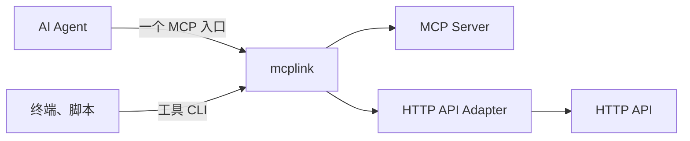

# mcplink

[](https://github.com/sw897/mcplink/actions/workflows/ci.yml)
[](LICENSE)

mcplink 是一个桌面 / CLI 工具，可以把多个 MCP Server 或 HTTP API 转为一个 Agent MCP 入口，还可以把 MCP 转为 CLI，提供给不支持 MCP 接入的 Agent。支持统一维护服务和认证，实现统一接入、单服务接入和 CLI 共享认证。

A desktop and CLI tool that turns MCP servers or HTTP APIs into one Agent MCP entry, and turns MCP into a CLI for agents without MCP support.

免费、MIT 开源，全本机管理功能，无需注册账号。上游服务仍保留各自的认证与访问要求。当前公开发布为 **[0.3.2 预览版](https://github.com/sw897/mcplink/releases/tag/v0.3.2)**。

[下载](#install-and-build) · [快速上手](#quick-start) · [HTTP API 转 MCP](#http-api-to-mcp) · [CLI 指南](docs/agent-cli.md) · [项目文档](docs/README.md)

<a id="core-capabilities"></a>

## 核心能力

| 能力 | 使用方式 |
| --- | --- |
| 统一 MCP 接入 | 每个 Agent 配置一个 `mcplink` 入口，使用所选服务的工具、资源和提示词。支持命名空间、每入口工具范围、分页和清单刷新通知。 |
| MCP 转 CLI | 把 MCP 转为可在终端、脚本和自动化里直接调用的命令，提供给不支持 MCP 接入的 Agent。支持 JSON stdin、Schema 校验、结构化结果和契约检查，并共享认证。 |
| HTTP API 转 MCP | 用声明式工具参数和 HTTP 请求/结果映射注册 Webservice，经同一个 MCP 入口和 CLI 使用，不必另写 MCP Server。 |



<a id="install-and-build"></a>

## 安装

下载 **[0.3.2 预览版](https://github.com/sw897/mcplink/releases/tag/v0.3.2)**，支持 macOS Apple Silicon 和 Windows x64。Release 提供安装包、独立 CLI、SHA-256 校验值和公开构建清单。

| 平台 | 安装方式 |
| --- | --- |
| macOS Apple Silicon | 打开 DMG 或 App ZIP，将 `mcplink.app` 复制到 `/Applications`。 |
| Windows x64 | 运行 NSIS 安装包；也可使用独立 CLI ZIP。 |
| 独立 CLI | 使用对应平台的 CLI 归档；或在源码目录运行 `cargo install --path crates/mcplink-core --locked`，并把 Cargo 的可执行目录加入 PATH。 |

将应用与 CLI 保留在固定路径。升级时同步更新桌面和独立 CLI，并重启后台。0.3.2 沿用数据语义版本 5，management API 升为 22；新的契约诊断要求新版后台。较早的程序仍会拒绝它不支持的数据目录。

macOS 预览包为 **ad-hoc 签名、未公证**，Windows 包 **未签名**。本版本不宣称正式发布者签名或系统信任；实际状态和源码提交见平台构建清单，下载后按平台 SHA256SUMS 核对。Intel Mac 和 Linux 暂无已验收的安装包。兼容性、签名和校验详见[发布说明](docs/release-notes.md)与[发布指南](docs/release.md)。成功的 [CI 构建](https://github.com/sw897/mcplink/actions/workflows/ci.yml)也提供 `packages-*` 工件。

[代码签名政策](CODE_SIGNING.md) · [隐私说明](PRIVACY.md) · [卸载与数据保留](docs/uninstall.md)。SignPath 开源 Windows 签名正在申请准备中；获批并完成验证前，上述预览包签名状态不变。

从源码开发与打包见[从源码构建](#build-from-source)。

<a id="quick-start"></a>

## 快速上手

1. 安装并打开 mcplink，或使用管理 CLI。
2. 导入已有服务，添加本地 STDIO 命令、远程 MCP 地址，或注册 HTTP API 定义。
3. 提供所需认证并查看工具。对 HTTP API，「查看工具」只读本地定义，不访问上游；「运行探测」须单独确认后才发出真实请求，可能产生费用或副作用。也可通过工具 CLI 明确调用一次。
4. 创建统一入口，选择服务和工具范围，再接到目标 Agent。核对并应用配置预览。
5. 重新加载 Agent 的 MCP 配置，实际调用一次工具以确认可用。

入口工具范围和工具 CLI 都可按搜索结果批量选择或取消，并保留搜索范围之外的选择；「清空全部选择」单独作用于全部工具。

之后在 mcplink 中调整服务选择，不必更换 Agent 侧的入口。支持实时刷新的客户端会收到清单变更通知，其他客户端需要重载 MCP。也可使用「通知 Agent 刷新」或 `mcplink gateway refresh ENTRY_ID`。

<a id="supported-agents"></a>

## 支持的 Agent

Codex、Hermes、Claude Code、OpenCode、ZCode、DeepSeek Harness、OpenClaw、Kimi Code、WorkBuddy、千问办公 (QwenWork)、Pi Agent、豆包工作 (Doubao Work)。

各客户端的配置作用域、支持操作和接入要求见 [Agent 兼容矩阵](docs/agent-discovery.md)。项目或 profile 来源需显式添加；插件和系统托管等来源保留原有权限。

<a id="agent-integration-and-authentication"></a>

## 入口、认证与配置

| 方式 | 连接与认证 |
| --- | --- |
| 统一入口 | 一个名为 `mcplink` 的条目提供所选服务，引用各成员原有的托管连接。工具、提示词和资源 URI 使用稳定命名空间。 |
| 单服务入口 | 一个 Bridge 提供一项托管服务，并保留上游名称。 |
| 工具 CLI | 直接调用或生成命令，与统一接入、单服务接入共享认证，供终端、脚本和不支持 MCP 接入的 Agent 使用，不必打开桌面或配置原生 MCP 客户端。 |
| 原生直连（可选） | Agent 自行连接上游并维护认证。普通 HTTP API 不能导出为原生 MCP 地址，须经 mcplink Adapter 以共享方式接入。 |

托管认证只在同一本机 mcplink 数据目录中，对同一服务连接、账号和授权范围复用。上游允许时会刷新 Token 或 OAuth grant；撤销或无法续期时需要重新认证。工具 CLI 引用这些连接，不另建账号。

共享配置保存本地程序入口和连接引用，上游凭据留在系统凭据库。直连配置包含完整地址、凭据和启动参数，应用前须核对保存与共享范围。

配置变更支持预览、并发修改检查、备份和逐条恢复。迁移到统一入口时，只有明确选择替换，才会移除成员服务已有的共享条目。移动程序后，须从新路径重新生成共享入口。

<a id="mcp-to-cli"></a>

## MCP 转 CLI

将下面的占位符换成已有托管连接 ID 和实际工具名：

```sh
mcplink connections tools CONNECTION_ID --tool TOOL_NAME
mcplink call CONNECTION_ID TOOL_NAME --stdin
mcplink cli generate CONNECTION_ID --name notes --output ./notes-cli --tool TOOL_NAME
mcplink cli check ./notes-cli/notes.mcplink.json
```

通过 stdin 传入工具参数 JSON。生成的命令清单不含凭据，调用时复用托管认证，并依赖本机 mcplink 运行时。也可在服务或统一入口中打开「工具 CLI」，查看参数、生成命令、检查契约，或明确执行一次调用。

契约检查区分工具变化、移除或范围排除，以及授权、通信或发现故障导致的未能核验；聚合入口按成员归因，健康工具仍可核验。检查会摘要已保存参数的变化，不把完整旧 Schema 写入清单，也不执行工具。输入格式、退出码和重新绑定见 [CLI 指南](docs/agent-cli.md)。

<a id="http-api-to-mcp"></a>

## HTTP API 转 MCP

注册基础 URL 和声明式 `httpApi` 工具定义，将路径、query、JSON 请求体和结果字段映射为 MCP 工具。

源码仓库提供两个无需 Key 的示例。[安装包和独立 CLI 归档不包含这些文件](https://github.com/sw897/mcplink/releases/tag/v0.3.2)；请在克隆的源码目录中运行，或从 [`examples/http-api/`](examples/http-api/) 取用定义：

```sh
mcplink connections save --stdin < examples/http-api/quickchart.json
mcplink connections save --stdin < examples/http-api/open-meteo.json
mcplink connections tools CONNECTION_ID
mcplink connections probe CONNECTION_ID
```

连接 ID 使用保存命令的返回值。QuickChart 将图表 JSON 渲染为 PNG，Open-Meteo 返回天气 JSON。例如：

```sh
mcplink call OPEN_METEO_CONNECTION_ID get_weather --stdin <<'JSON'
{"latitude":31.23,"longitude":121.47,"timezone":"Asia/Shanghai"}
JSON
```

把两项服务加入同一个统一入口，即可由每个 Agent 的一个 MCP 条目调用，也可直接经 CLI 使用。

`connections tools` 只检查本地定义，不访问上游；`verification.upstream: not_checked` 表示尚未核验，不是网络错误。示例中显式配置的 probe 由 `connections probe` 执行，会发出一次真实 API 请求，可能产生费用或副作用；先核对探测操作再执行。桌面「查看工具」和取消探测不会发请求，「运行探测」需要单独确认。打开确认之后、请求发出之前，若定义或凭据已变化，桌面会拒绝该次确认，须重新查看后再确认。超时或结果不明时先核对，不要自动重试。

Adapter 支持 JSON、UTF-8 文本、PNG/JPEG/WebP 图片字节和映射后的 Base64 图片结果；图片作为 MCP 图片内容返回。凭据使用托管请求头。普通 HTTP API 不做 MCP OAuth 发现，也不能导出为原生 MCP 直连地址。

当前采用显式操作定义，尚未提供 OpenAPI 导入、multipart 上传或异步任务。公共服务保留各自的限额与条款；Open-Meteo 免费入口限非商业用途。定义方式、映射规则和限制见 [HTTP Adapter 指南](docs/http-api.md)。

<a id="management-cli-and-skill"></a>

## 管理 CLI 与 Skill

Agent 和脚本可以在无界面的情况下管理 mcplink。先以安装版本的 JSON 命令契约和实际连接状态为准，不要假设命令或 ID：

```sh
mcplink schema
mcplink status
```

桌面、管理 CLI 和内置 Skill 共用连接、凭据、配置预览与恢复操作。Skill 随 CLI 一并提供，可用 `mcplink skill show` 查看，或用 `mcplink skill install --agent AGENT` 安装到 Codex、Hermes、Claude Code 或 OpenCode。macOS 菜单栏和 Windows 托盘支持登录启动、暂停状态保存和退出控制。命令与管理流程见 [CLI 指南](docs/agent-cli.md)，Agent 侧约定见 [Skill](skills/mcplink/SKILL.md)。

<a id="data-and-authorization"></a>

## 数据、认证与边界

连接元数据和配置历史保存在本机，托管凭据使用系统凭据库。配置备份可能包含原生文件中已有的明文凭据，应按原文件的敏感程度保管。mcplink 不提供云同步，也不要求 mcplink 账号。卸载与保留范围见[卸载指南](docs/uninstall.md)。

MCP 服务支持 STDIO、Streamable HTTP 以及普通的 tools、resources、prompts 请求。HTTP API 成员通过 Adapter 提供工具。认证与工具行为遵循上游契约，范围和容量限制见[支持范围](docs/compatibility.md)。问题报告请使用合成数据；安全问题按 [SECURITY.md](SECURITY.md) 报告。

<a id="build-from-source"></a>

## 从源码构建

桌面采用 Tauri 2、React、TypeScript 和 Rust。请安装 [.node-version](.node-version) 固定的 Node.js 22 LTS（最低 22.12.0）、[rust-toolchain.toml](rust-toolchain.toml) 中的工具链、Python 3.11+，以及 [Tauri 平台构建工具](https://v2.tauri.app/start/prerequisites/)。macOS 需要 Xcode Command Line Tools，Windows 需要 MSVC 构建工具和 WebView2。

```sh
git clone https://github.com/sw897/mcplink.git
cd mcplink
npm ci
npm run desktop
```

| 命令 | 用途 |
| --- | --- |
| `npm run build` | 检查类型并构建前端。 |
| `npm run check` | 检查 Rust 格式并运行静态分析。 |
| `npm run release:macos` | 构建并校验 macOS DMG、App ZIP 和 CLI 归档。 |
| `npm run release:windows` | 构建并校验 Windows NSIS 安装包和 CLI ZIP。 |

候选产物位于 `artifacts/releases/<版本>/<时间>/`，bundle 产物位于 `target/release/bundle/`。干净构建、签名和公开分发见[发布指南](docs/release.md)。本地验证入口见 [CONTRIBUTING.md](CONTRIBUTING.md) 和 [端到端测试说明](tests/e2e/README.md)。

<a id="documentation-and-contributing"></a>

## 文档与参与

- [产品定位](docs/product.md) · [文档索引](docs/README.md) · [Agent 接入](docs/agent-discovery.md) · [CLI 指南](docs/agent-cli.md)
- [HTTP API Adapter 指南](docs/http-api.md) · [架构](docs/architecture.md) · [配置适配](docs/agent-adapters.md) · [兼容范围](docs/compatibility.md)
- [发布指南](docs/release.md) · [路线图](ROADMAP.md) · [参与开发](CONTRIBUTING.md) · [问题反馈](https://github.com/sw897/mcplink/issues)

<a id="license"></a>

## 许可

[MIT](LICENSE)。再分发时保留 [THIRD_PARTY_NOTICES.txt](THIRD_PARTY_NOTICES.txt)，依赖及许可说明见 [docs/DEPENDENCIES.md](docs/DEPENDENCIES.md)。
