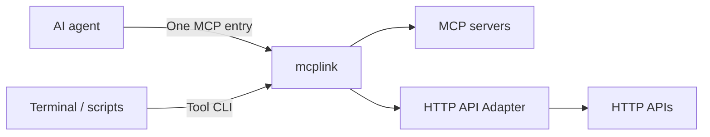

# mcplink

[](https://github.com/sw897/mcplink/actions/workflows/ci.yml)
[](LICENSE)

English · [简体中文](README.zh-CN.md)

mcplink connects MCP servers and ordinary HTTP APIs through one MCP entry per agent, and makes their tools callable from terminals, scripts, and automation. Manage services, authentication, and tool access from the desktop or CLI.

Unified entries, single-service entries, and tool CLIs reuse the same managed connections. Free and MIT-licensed, with no mcplink account required. Upstream services retain their own authentication and access requirements.

[Download](#install-and-build) · [Quick start](#quick-start) · [HTTP API Adapter](#http-api-to-mcp) · [CLI guide](docs/agent-cli.md) · [Documentation](docs/README.md)

## Core capabilities

| Capability | How you use it |
| --- | --- |
| Unified MCP access | Configure one `mcplink` entry per agent to use selected services. Aggregate tools, resources, and prompts with namespaces, per-entry tool ranges, pagination, and refresh notifications. |
| MCP-to-CLI | Call tools directly or generate named commands. Use JSON stdin, schema validation, structured results, contract checks, and the same managed authentication. |
| HTTP API-to-MCP | Register a web service with declarative tool parameters and HTTP request/response mappings. Use its tools through the same MCP entry and CLI, without writing a separate MCP server. |



## Install and build

Download the **[0.3.0 preview](https://github.com/sw897/mcplink/releases/tag/v0.3.0)** for macOS Apple Silicon or Windows x64. The release includes installers, standalone CLIs, SHA-256 checksums, and public build manifests.

| Platform | Installation |
| --- | --- |
| macOS Apple Silicon | Open the DMG or App ZIP and copy `mcplink.app` to `/Applications`. |
| Windows x64 | Run the NSIS installer. A standalone CLI ZIP is also available. |
| Standalone CLI | Use the platform's CLI archive, or run `cargo install --path crates/mcplink-core --locked` from a source checkout and add Cargo's executable directory to PATH. |

Keep the application and CLI at permanent paths. Upgrade the desktop and standalone CLI together, then restart the background process. Version 0.3.0 uses data semantics 5 and management API 21; older binaries refuse the newer data directory.

The macOS preview uses ad-hoc signing and is not notarized; Windows packages are unsigned. Intel Mac and Linux do not have validated installer packages. See the [release notes](docs/release-notes.md) and [release guide](docs/release.md) for compatibility, signing, and checksum details. Successful [CI builds](https://github.com/sw897/mcplink/actions/workflows/ci.yml) also provide `packages-*` artifacts.

For development and packaging commands, see [Build from source](#build-from-source).

## Quick start

1. Install mcplink and open it, or use the management CLI.
2. Import an existing service, add a local STDIO command or remote MCP URL, or register an HTTP API definition.
3. Supply any required authentication and inspect the available tools. For HTTP APIs, use managed headers and an actual call or explicit probe to verify access.
4. Create a unified entry, select services and tool ranges, then connect it to the target agent. Review and apply the proposed configuration changes.
5. Reload the agent's MCP configuration and make a tool call to confirm access.

Update service selection in mcplink while retaining the same agent entry. Clients with live refresh receive list-change notifications; other clients need MCP reload. Use “Notify agents to refresh” or `mcplink gateway refresh ENTRY_ID` to request a fresh list.

## Supported agents

Codex, Hermes, Claude Code, OpenCode, ZCode, DeepSeek Harness, OpenClaw, Kimi Code, WorkBuddy, QwenWork (千问办公), Pi Agent, and Doubao Work (豆包工作).

Configuration scopes, supported operations, and client requirements are listed in the [Agent compatibility matrix](docs/agent-discovery.md). Project and profile sources are added explicitly; plugin and managed sources retain their permissions.

## Agent integration and authentication

| Mode | Connection and authentication |
| --- | --- |
| Unified entry | One `mcplink` entry exposes selected services and reuses each member's managed connection. Tools, prompts, and resource URIs use stable namespaces. |
| Single-service entry | A Bridge exposes one managed service and preserves its upstream names. |
| Native direct connection (optional) | The agent connects to the upstream itself and maintains its own authentication. Ordinary HTTP APIs require the mcplink Adapter and shared access. |

Managed authentication is reused only for the same service connection, account, and authorization scope within one local mcplink data directory. Tokens or OAuth grants refresh when the upstream permits it; revoked or nonrenewable grants need reauthorization. Tool CLIs reference these same connections without creating another account.

Shared agent configurations contain launcher and connection references; upstream credentials stay in the system credential store. Direct configurations contain complete URLs, credentials, and launch arguments. Review their storage and sharing scope before applying them.

Configuration changes support preview, concurrent-edit checks, backups, and per-operation recovery. Migrating to a unified entry replaces existing member-service shared entries only when explicitly selected. After moving the executable, regenerate shared entries from its new path.

## MCP-to-CLI

Call a connection's tools directly or generate commands for selected tools. The caller needs the local mcplink runtime, without having to open the desktop or configure a native MCP client. Replace the placeholders with a managed connection ID and an actual tool name:

```sh
mcplink connections tools CONNECTION_ID --tool TOOL_NAME
mcplink call CONNECTION_ID TOOL_NAME --stdin
mcplink cli generate CONNECTION_ID --name notes --output ./notes-cli --tool TOOL_NAME
mcplink cli check ./notes-cli/notes.mcplink.json
```

Pass the tool's argument JSON to stdin. Generated commands keep credentials out of their manifests and reuse managed authentication. Open **Tool CLI** from a service or unified entry to inspect parameters, generate commands, check contracts, or explicitly invoke a tool once. See the [CLI guide](docs/agent-cli.md) for input formats, exit codes, and rebinding.

## HTTP API-to-MCP

Register a base URL and a declarative `httpApi` tool definition. Path and query parameters, JSON request bodies, and response mappings turn ordinary HTTP operations into MCP tools. This capability is available from 0.3.0.

Two keyless examples are included:

```sh
mcplink connections save --stdin < examples/http-api/quickchart.json
mcplink connections save --stdin < examples/http-api/open-meteo.json
mcplink connections tools CONNECTION_ID
mcplink connections probe CONNECTION_ID
```

Use the IDs returned by registration. QuickChart renders chart JSON as a PNG; Open-Meteo returns weather JSON. For example, replace `OPEN_METEO_CONNECTION_ID` with the weather connection's ID:

```sh
mcplink call OPEN_METEO_CONNECTION_ID get_weather --stdin <<'JSON'
{"latitude":31.23,"longitude":121.47,"timezone":"Asia/Shanghai"}
JSON
```

Add both services to a unified entry for one MCP entry per agent, or call them through the CLI. Listing tools checks only the local definition. The examples' explicitly configured probes make one real API call.

The adapter supports JSON, UTF-8 text, PNG/JPEG/WebP image bytes, and mapped Base64 image responses. Images return as MCP image content. Credentials use managed headers; MCP OAuth discovery and native direct export do not apply to ordinary HTTP APIs.

Operations are defined explicitly. OpenAPI import, multipart uploads, and asynchronous jobs are not included. Public services retain their rate limits and terms; Open-Meteo's free endpoint is for non-commercial use. See the [HTTP Adapter guide](docs/http-api.md) for definitions, mapping rules, and limits.

## Management CLI and Skill

Agents and scripts can manage mcplink without UI. Start with the installed build's JSON command contract and actual connection state:

```sh
mcplink schema
mcplink status
```

The desktop, management CLI, and bundled Skill share connection, credential, configuration-preview, and recovery operations. Service inventory, account labels, tool policies, and background controls are maintained through the same core. macOS menu bar and Windows tray controls support login startup, persistent pause, and exit options. See the [CLI guide](docs/agent-cli.md) for installation and management workflows.

## Build from source

The desktop uses Tauri 2, React, TypeScript, and Rust. Install Node.js 22 LTS as pinned in [.node-version](.node-version) (minimum 22.12.0), the toolchain in [rust-toolchain.toml](rust-toolchain.toml), Python 3.11+, and the [Tauri platform prerequisites](https://v2.tauri.app/start/prerequisites/). macOS requires Xcode Command Line Tools; Windows requires MSVC build tools and WebView2.

```sh
git clone https://github.com/sw897/mcplink.git
cd mcplink
npm ci
npm run desktop
```

| Command | Purpose |
| --- | --- |
| `npm run build` | Type-check and build the frontend. |
| `npm run check` | Check Rust formatting and run static analysis. |
| `npm run release:macos` | Build and verify the macOS DMG, App ZIP, and CLI archive. |
| `npm run release:windows` | Build and verify the Windows NSIS installer and CLI ZIP. |

Candidates go to `artifacts/releases/<version>/<timestamp>/`; bundle output is under `target/release/bundle/`. See the [release guide](docs/release.md) for clean builds, signing, and public distribution.

## Data and authorization

Connection metadata and configuration history stay on your computer. Managed credentials use the system credential store. Configuration backups may contain plaintext credentials already present in native files and need the same protection as the originals.

MCP services support STDIO and Streamable HTTP with ordinary tools, resources, and prompts requests. HTTP API members expose tools through the Adapter. Upstream contracts determine authentication and tool behavior; see [supported scope](docs/compatibility.md). Use synthetic data in issue reports and follow [SECURITY.md](SECURITY.md) for security disclosures.

## Documentation and contributing

- [Product definition](docs/product.md) · [Documentation index](docs/README.md) · [Agent integration](docs/agent-discovery.md) · [CLI guide](docs/agent-cli.md)
- [Architecture](docs/architecture.md) · [Configuration adapters](docs/agent-adapters.md) · [Compatibility](docs/compatibility.md)
- [Release guide](docs/release.md) · [Roadmap](ROADMAP.md) · [Contributing](CONTRIBUTING.md) · [Issues](https://github.com/sw897/mcplink/issues)

## License

[MIT](LICENSE). Keep [THIRD_PARTY_NOTICES.txt](THIRD_PARTY_NOTICES.txt) when redistributing; see [dependency and license details](docs/DEPENDENCIES.md).
