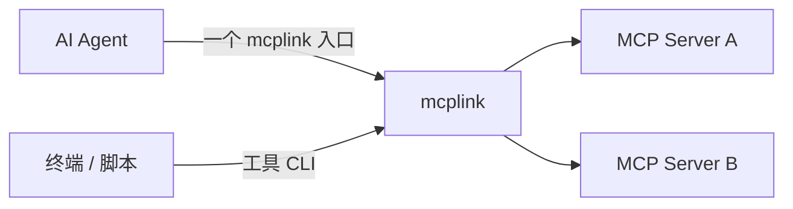

# mcplink：MCP 统一接入与 CLI 转换

[](https://github.com/sw897/mcplink/actions/workflows/ci.yml)
[](LICENSE)

[English](README.md) · 简体中文

mcplink 将多个 MCP Server 汇集到每个 Agent 的一个入口中，也能把工具转成终端、脚本和自动化任务可调用的 CLI。服务、认证和工具范围可通过桌面或 CLI 统一维护。

普通 HTTP API 也能通过声明式 HTTP API → MCP Adapter 接入这个入口。配置一次工具参数、HTTP 请求与结果映射，Agent 和工具 CLI 即可复用同一个托管连接。

单服务入口、聚合入口和工具 CLI 共用托管认证。同一服务连接完成相应账号和授权范围的认证后，可供多个 Agent 和命令复用。原生直连作为可选方式，由客户端维护认证。完整定义与验收标准见[产品定位](docs/product.md)。

免费、MIT 开源，本机管理无需注册 mcplink 账号。上游服务仍按各自的规则认证和授权。

[快速上手](#快速上手) · [安装与构建](#安装与构建) · [CLI 指南](docs/agent-cli.md) · [项目文档](docs/README.md)

## 核心能力

| 能力 | 用户目标 | 当前状态 |
| --- | --- | --- |
| 多 MCP Server 统一接入 | 每个 Agent 配置一个 `mcplink` 入口，在 mcplink 内选择和维护多个服务 | 聚合所选服务的工具、资源和提示词；支持每入口工具范围、稳定分页、清单刷新通知和上游故障诊断 |
| MCP 转 CLI | 将 MCP 工具转成可直接调用或按需生成的命令，支持参数校验、JSON 输入输出与自动化 | 工具调用、JSON Schema 校验、具名命令生成，以及桌面参数查看、实际调用、契约检查和重新绑定 |
| HTTP API 转 MCP | 将 Webservice 注册为 MCP 工具，无需单独编写 Server | 声明式路径/query/JSON 映射、托管请求头、JSON/文本/图片结果，以及统一入口和 CLI 调用 |

HTTP API 转 MCP 支持路径、query、JSON 请求映射，托管请求头认证，以及 JSON、文本和图片结果；与现有 MCP 服务共用统一入口和 CLI。桌面界面、认证维护、客户端适配和后台运行围绕这些能力提供支持。

## 已有配套功能

- **服务盘点**：查看本机 MCP 服务、配置来源、连接状态和可用工具。
- **连接与账号**：新建或导入连接，维护账号标签，管理 Token 或 OAuth 授权。
- **Agent 配置管理**：通过预览维护单服务入口、聚合入口或可选原生直连；明确选择迁移时替换成员服务的已有共享条目。
- **预览与恢复**：检查配置变更，检测并发修改，备份文件并逐条恢复操作。
- **管理入口**：桌面、JSON CLI 和内置管理 Skill 使用同一个管理核心。
- **后台控制**：通过 macOS 菜单栏或 Windows 托盘管理共享网关、登录启动、暂停状态和退出方式。

## 支持的 Agent

Codex、Hermes、Claude Code、OpenCode、ZCode、DeepSeek Harness、OpenClaw、Kimi Code、WorkBuddy、千问办公、Pi Agent、豆包工作。

各客户端的配置作用域、支持操作和接入要求统一列在 [Agent 兼容矩阵](docs/agent-discovery.md)。项目或 profile 来源需显式添加；插件和系统托管等来源保留原有权限。

## Agent 接入与认证

添加服务并完成托管认证后，可以选择以下方式：

| 方式 | 运行方式 | 适用情况 |
| --- | --- | --- |
| 单服务入口 | Agent 的该服务条目通过 Bridge 调用托管连接。 | 按服务接入，复用托管认证。 |
| 聚合入口 | Agent 只配置一个 `mcplink` 条目，提供入口中选择的多个服务。 | 集中增删服务，保留同一个 Agent 配置入口。 |
| 原生直连（可选） | Agent 使用自身配置，直接启动或连接上游。 | 由客户端维护连接及认证。 |

托管调用结构：



直连配置包含完整地址、凭据和启动参数，应用前需核对保存及共享范围。共享配置只保存本地程序入口和连接引用，上游凭据留在系统凭据库中。

桌面“统一入口”页创建入口、选择服务与工具范围，再接给指定 Agent。不同 Agent 可使用不同入口，也可共用同一入口。修改选择无需重写原生配置。支持实时刷新的客户端会收到清单变更通知；其他客户端仍需重新加载 MCP。也可点击“通知 Agent 刷新”或运行 `mcplink gateway refresh ENTRY_ID`。单服务入口保留上游名称；聚合入口使用稳定命名空间处理工具、提示词和资源 URI 冲突。

托管认证复用限于同一 mcplink 数据目录中的同一服务连接、账号与授权范围。上游支持时自动刷新，撤销或无法续期时重新认证；原生直连不承诺共用托管 OAuth 登录态。CLI 同样引用托管连接，不另建账号。

## 快速上手

1. 安装预览构建，或从源码构建并打开 mcplink。设置共享接入前，将应用或独立 CLI 放在长期保留的位置。
2. 查看发现的服务与 Agent，按需添加项目或 profile 配置来源。
3. 导入已有连接，填写 STDIO 命令、远程 MCP 地址，或注册 HTTP API 工具定义。完成所需认证，再检查工具清单。
4. 在“统一入口”页创建入口并选择服务，再接给目标 Agent；也可直接为某个服务选择单服务入口或原生直连。核对预览，按界面提示完成接入。
5. 重新加载客户端的 MCP 配置，并做一次实际工具调用确认结果。

后续可在服务与账号页面更新托管授权，在变更历史中检查和恢复操作。移动程序后，需要从新位置重新生成共享入口。

## 安装与构建

下载 **[0.3.0 预览版](https://github.com/sw897/mcplink/releases/tag/v0.3.0)**，支持 macOS Apple Silicon 和 Windows x64。Release 提供安装包、独立 CLI、SHA-256 校验值和公开构建清单；[GitHub Actions](https://github.com/sw897/mcplink/actions/workflows/ci.yml) 的成功构建也提供 `packages-*` 工件。版本变化与签名状态见[发布说明](docs/release-notes.md)。

升级时同步更新桌面与独立 CLI，并重启后台。版本兼容、包校验值及签名状态见[发布指南](docs/release.md)。

技术栈为 Tauri 2、React、TypeScript 和 Rust。安装 [.node-version](.node-version) 固定的 Node.js 22 LTS（最低 22.12.0）、[rust-toolchain.toml](rust-toolchain.toml) 中的工具链、Python 3.11+ 及 [Tauri 平台构建工具](https://v2.tauri.app/start/prerequisites/)。

macOS 需要 Xcode Command Line Tools；Windows 需要 MSVC 构建工具和 WebView2。

```sh
git clone https://github.com/sw897/mcplink.git
cd mcplink
npm ci
npm run desktop
```

| 目标 | 构建与安装 |
| --- | --- |
| macOS Apple Silicon | `npm run release:macos` 生成 DMG 和 App ZIP，将 `mcplink.app` 安装到 `/Applications`。 |
| Windows x64 | `npm run release:windows` 生成经过验收的预览候选，包含 NSIS 安装包与独立 CLI ZIP。 |
| 独立 CLI | `cargo install --path crates/mcplink-core --locked`，将 Cargo 的可执行目录加入 PATH。 |

`npm run build` 构建前端，`npm run check` 检查 Rust 格式与静态问题。发布候选位于 `artifacts/releases/<版本>/<时间>/`，`bundle` 产物位于 `target/release/bundle/`。

默认 macOS 预览包使用 ad-hoc 签名，Windows 安装包未签名。签名、公证、构建清单和校验值见[发布指南](docs/release.md)。Intel Mac 和 Linux 暂无已验收的安装包。

## MCP 转 CLI

CLI 可以直接调用托管连接中的工具，也可以为选定工具生成具名命令入口。无需给调用方配置原生 MCP 连接或启动桌面。以下命令使用已有托管连接 ID 和上游实际提供的工具名：

```sh
mcplink connections tools CONNECTION_ID --tool TOOL_NAME
mcplink call CONNECTION_ID TOOL_NAME --stdin
mcplink cli generate CONNECTION_ID --name notes --output ./notes-cli --tool TOOL_NAME
mcplink cli check ./notes-cli/notes.mcplink.json
```

`call --stdin` 接收工具参数 JSON。生成物复用本机 mcplink 运行时和托管认证，不包含凭据；使用方法与错误边界见 [CLI 指南](docs/agent-cli.md)。

从托管服务或统一入口的“工具 CLI”打开工作流，查看参数、勾选工具、生成到新目录，也可以明确触发一次实际调用。已有清单可检查当前契约，变化后核对参数并生成到新目录，原文件保留。

## HTTP API 转 MCP

从 0.3.0 开始提供，使用 management API 21。升级时应同步更新桌面、CLI 与后台；0.2.1 构建不包含 Adapter。

通过基础 URL 和 `httpApi` 工具定义注册普通 Webservice，无需为每项服务另外编写 MCP Server：

```sh
mcplink connections save --stdin < examples/http-api/quickchart.json
mcplink connections save --stdin < examples/http-api/open-meteo.json
mcplink connections tools CONNECTION_ID
mcplink connections probe CONNECTION_ID
mcplink call OPEN_METEO_CONNECTION_ID get_weather --stdin
```

连接 ID 使用保存命令的返回值。QuickChart 示例将图表 JSON 转为 PNG；Open-Meteo 示例将坐标转为天气 JSON，两者均可无 Key 调用。将两个连接加入同一个统一入口，即可由每个 Agent 的一个 `mcplink` 条目调用，也能通过直接调用和生成的 CLI 使用。

工具发现只读取本地定义；示例中的显式 probe 会执行一次真实 API 调用。图片以 MCP 图片内容返回，凭据仍使用托管请求头。普通 API 需要共享接入，不能直接当成原生 MCP 地址导出。

首版采用显式工具定义，尚未提供 OpenAPI 导入、multipart 上传或异步任务。公共免费接口受上游限额约束；Open-Meteo 的免费入口限非商业用途。完整配置、调用与验证说明见 [HTTP Adapter 指南](docs/http-api.md)。

## 管理 CLI 与 Skill

CLI 提供 JSON 输出和 stdin 输入，供脚本和 Agent 使用。先检查当前安装版本的命令与连接状态：

```sh
mcplink schema
mcplink status
```

内置管理 Skill 使用同一套 CLI 和配置事务。安装目标、连接设置、授权、工具调用、命令生成和恢复操作见 [CLI 指南](docs/agent-cli.md)。

## 数据与认证

连接元数据和配置历史保存在本机，托管凭据使用系统凭据库。配置备份可能包含原生文件中已有的明文凭据，需要按原文件的敏感程度保管。

支持 STDIO、Streamable HTTP 及普通 tools、resources、prompts 请求。认证与工具行为遵循上游服务契约。平台和协议限制见[支持范围](docs/compatibility.md)；问题报告请使用合成样例，安全问题按 [SECURITY.md](SECURITY.md) 报告。

## 文档与参与

- [产品定位](docs/product.md) · [文档索引](docs/README.md) · [Agent 接入](docs/agent-discovery.md) · [CLI 指南](docs/agent-cli.md)
- [架构](docs/architecture.md) · [配置适配](docs/agent-adapters.md) · [兼容范围](docs/compatibility.md)
- [发布指南](docs/release.md) · [路线图](ROADMAP.md) · [参与开发](CONTRIBUTING.md) · [Issues](https://github.com/sw897/mcplink/issues)

## 许可

[MIT](LICENSE)。再分发时保留 [THIRD_PARTY_NOTICES.txt](THIRD_PARTY_NOTICES.txt)，依赖及许可说明见 [docs/DEPENDENCIES.md](docs/DEPENDENCIES.md)。
