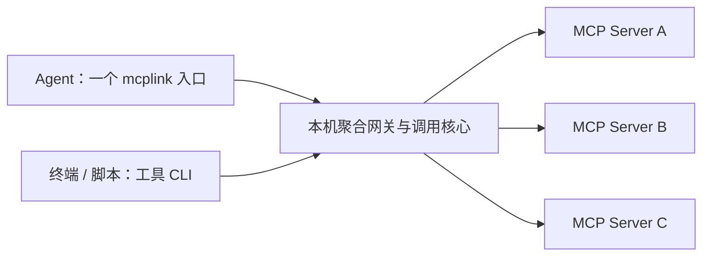

# 产品定位

mcplink 的核心价值是：在一处接入多个 MCP Server，通过统一 MCP 入口或 CLI 使用它们。

产品围绕两项能力组织：多 MCP Server 统一接入、MCP 转 CLI。桌面界面、认证维护、客户端适配与后台运行为这两项能力提供支持。

## 多 MCP Server 统一接入

每个 Agent 可以配置一个名为 `mcplink` 的聚合入口，由本机后台提供该入口选中的多个上游服务。入口只引用已有托管连接，不另建账号、不复制授权。

- 在 mcplink 中添加本地 STDIO 或远程 HTTP MCP 服务，维护连接与认证。
- 聚合所支持的工具、资源和提示词清单，处理名称及资源 URI 冲突，并将请求路由到正确的服务与账号。
- 在 mcplink 内为不同 Agent 保存不同的入口服务选择，也可让多个 Agent 使用同一入口。各服务已有的工具筛选同时作用于单服务入口、聚合入口和 CLI。
- 后续添加、移除或调整服务时，Agent 保留同一个入口；工具清单按客户端能力刷新，必要时重新加载或开启会话。
- 一个服务不可用时，其他服务仍可发现和调用，并明确指出失败的上游。

一个后台能管理多个服务是内部运行机制。逐服务创建多个 Bridge 条目不满足统一接入目标，修改这些条目的显示名称也不构成聚合。

## 一份服务定义，三种托管使用方式

| 方式 | Agent 或调用方如何使用 | 账号认证 |
| --- | --- | --- |
| 单服务入口 | 在目标 Agent 中配置某个服务的 Bridge | 引用该服务的托管连接 |
| 聚合入口 | 在 Agent 中配置一个 `mcplink` 条目，提供多个所选服务 | 引用各成员服务原有的托管连接 |
| 工具 CLI | 直接调用工具或生成命令入口，通过终端使用 | 引用同一托管连接；也可选择聚合入口中的工具 |

一次认证的范围是同一本机 mcplink 数据目录中，同一服务、账号和授权范围对应的托管连接。多个 Agent 与 CLI 复用该连接的 Token 或 OAuth grant，由后台维护刷新；更新或断开认证同时影响这些托管路径。不同服务、账号或数据目录分别维护授权，上游撤销或无法续期时需要重新认证。

原生直连作为可选方式保留：mcplink 写入或生成上游配置，Agent 自行连接并维护认证。静态凭据更新需要另行同步，不能把托管 OAuth 登录态通用复制给各客户端。

## MCP 转 CLI

将 MCP 工具转成可以在终端、脚本和自动化任务中调用的命令。使用者无需配置原生 MCP 客户端或打开桌面界面。

- 从真实工具 Schema 发现工具与参数，生成可读的命令、帮助和参数说明。
- 支持直接调用工具，以及为选定工具生成具名 CLI 入口。
- 保留对象、数组、布尔值和数值类型；复杂或敏感参数支持 JSON stdin。
- 提供结构化结果与明确退出码，区分命令错误、协议错误和工具失败；上游在成功正文中封装的业务错误仍按其契约判断。
- CLI 与 MCP 入口复用托管服务、认证及工具策略，凭据不写入生成物。
- 工具契约变化时能够检测并提示更新；执行结果不确定时不自动重发调用。

当前生成的 CLI 是依赖本机 mcplink 运行时的轻量入口，不是可脱离运行时的独立 MCP 实现。命令与限制见 [CLI 指南](agent-cli.md)。

## 目标调用结构

单服务 Bridge 和聚合 Bridge 都通过本地认证的 RPC 调用同一后台，CLI 使用同一调用核心。认证复用以成员连接 ID 为准，不依靠服务显示名匹配账号。当前后台按连接复用上游会话，不把所有服务合并成一个上游会话。

## 当前实现状态

| 核心能力 | 已有实现 | 后续完善 |
| --- | --- | --- |
| 多 MCP Server 统一接入 | 单入口聚合工具、资源与提示词，命名空间路由、固定快照分页、入口服务和工具范围、清单通知与上游故障诊断 | 更多客户端互操作、更完整的协议会话交互 |
| MCP 转 CLI | `call`、工具 Schema 校验、JSON stdin、结构化输出、选择服务或聚合入口生成 CLI、桌面生成与调用工作流、契约检查与重新绑定 | 持续完善批量工具维护体验 |

桌面“统一入口”页管理服务选择；CLI 使用 `gateway list` 和 `gateway save --stdin`。入口保存后服务选择立即生效，Agent 按客户端能力刷新清单，必要时重新加载 MCP 或开启新会话。支持的清单发送变更通知；客户端不支持实时刷新时仍需重载。每个入口可独立限制工具范围，继续共用成员账号。

接入已有 Agent 时，可明确选择替换同一来源中的成员单服务共享条目，预览会列出移除和新增操作；原生直连保留。默认不移除已有条目。空服务选择提供空清单，删除入口不删除上游账号；删除被入口引用的服务前，须先从入口移除。

当前客户端配置管理能力见[兼容矩阵](agent-discovery.md)，协议及容量边界见[兼容说明](compatibility.md)。命令以安装版本的 `mcplink schema` 为准。

## 验收标准

统一接入必须能从真实客户端的一个 MCP 条目发现并调用至少两个独立上游服务。还需验证重名能力的准确路由、每个 Agent 的服务选择、单个上游故障、服务清单变化及重新加载后的行为。仅后台能同时连接多个服务不算完成。

MCP 转 CLI 必须从真实 Schema 完成工具发现、命令生成、参数校验和实际调用，覆盖结构化参数、错误退出、认证更新及工具契约变化。生成文件成功不等于工具调用验收成功。

## 配套能力与优先级

服务盘点、系统凭据库、OAuth、配置预览与恢复、后台生命周期和跨平台分发用于保障上述两项能力。Skill 安装与客户端配置适配是使用支持，不单独定义产品的核心价值。

后续围绕聚合入口的互操作、工具策略及 CLI 体验迭代。新增客户端数量和逐服务代理数量不作为统一接入的完成指标。具体方向见[路线图](../ROADMAP.md)，当前结构见[架构](architecture.md)。
